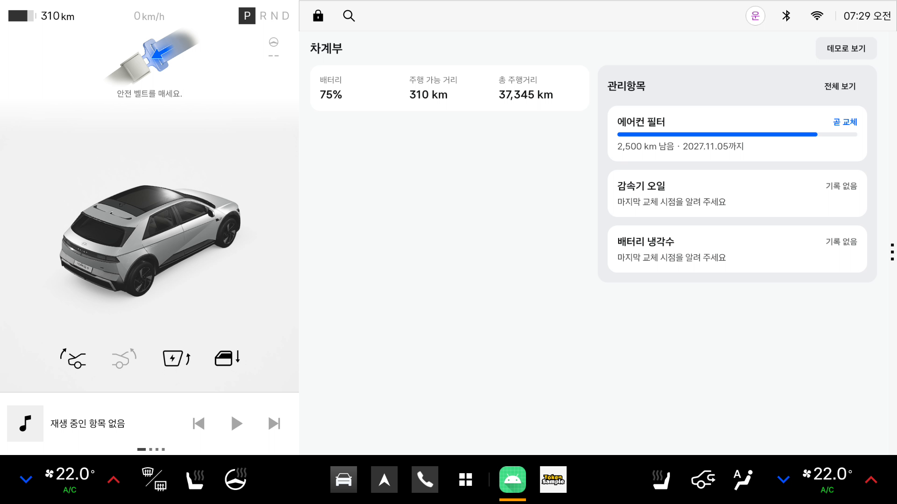
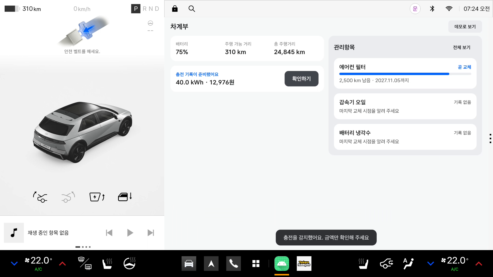
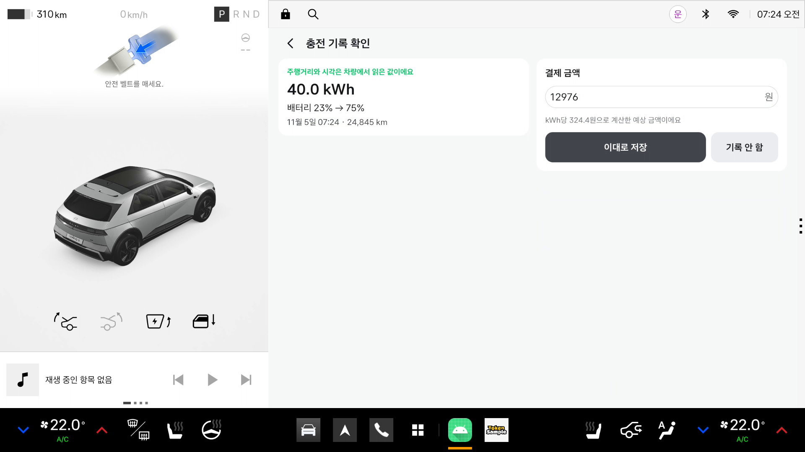
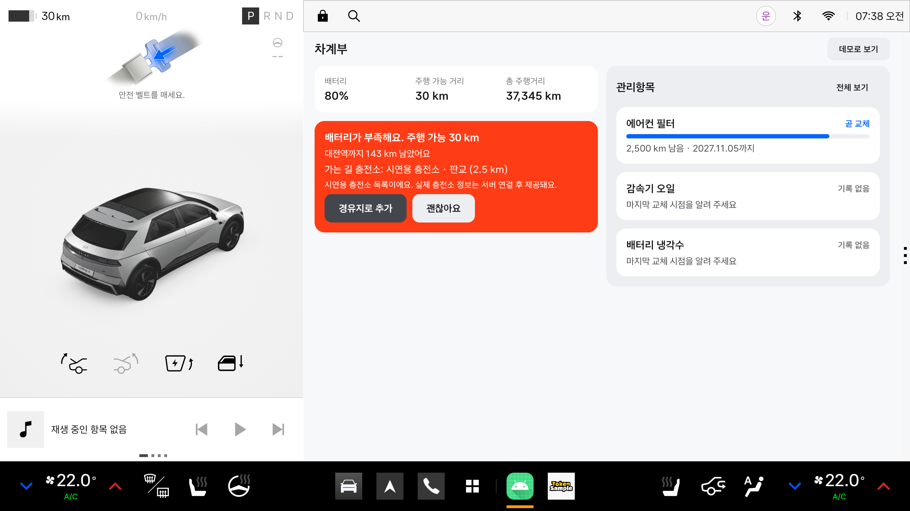
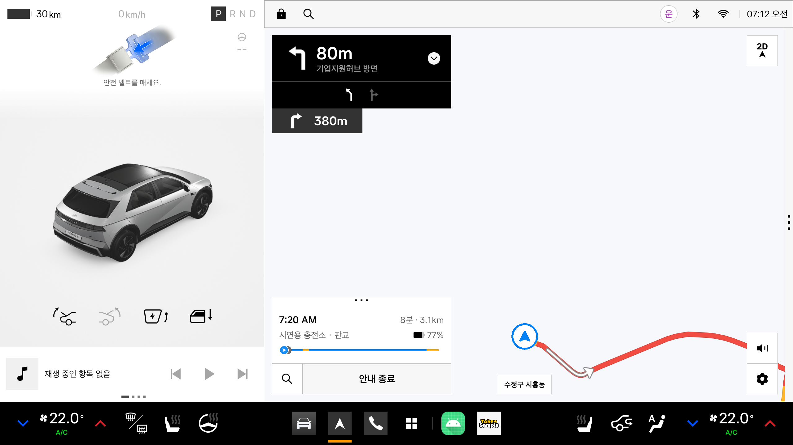

# 차곡: 차가 직접 쓰는 차계부

현대자동차그룹 차량용 앱 개발 공모전 출품작. Pleos Connect(AAOS) 차량 앱이다.

차량이 주행거리와 배터리·연료를 직접 읽어 기록하고, 소모품 교체 시점을 스스로 맞추고, 필요한 충전소를 가는 길에 내비 경유지로 넣어 준다. 운전자는 금액만 확인하면 된다.

## 시연 흐름

세 흐름 모두 Pleos Connect 에뮬레이터에서 Virtual Console로 바꾼 차량 신호를 Vehicle SDK·NaviHelper SDK로 받아 동작한다.

### 1. 주행거리가 오르면 관리항목 진행률이 오른다

관리항목에서 "오늘 교체했어요"를 누르면 그 순간의 차량 주행거리로 기록된다. 이후 주행거리가 오르면 진행 막대가 따라 오르고, 80%를 넘으면 "곧 교체"가 된다. 기간은 달력 월로 계산한다.



### 2. 충전을 감지하면 기록 초안이 생기고, 확인만 누르면 저장된다

충전구가 열리고 배터리가 1kWh 넘게 오른 뒤 닫히면 충전 기록 초안이 생긴다. 다른 앱(내비)이 화면을 덮고 있어도 감지한다. 확인 화면에서 금액만 확인하면 차량에서 읽은 주행거리·시각과 함께 저장된다. VIN을 주는 차량에서는 VIN 해시도 함께 남는다(에뮬레이터는 VIN이 없다).

| 감지 | 확인 |
|---|---|
|  |  |

### 3. 배터리가 부족하면 충전소가 내비 경유지로 들어간다

경로가 있고 주행 가능 거리가 `max(50km, 남은 거리 × 1.2)`보다 짧으면, 진행 방향의 충전소를 한 번 제안한다. 추가를 누르면 NaviHelper로 첫 번째 경유지에 넣는다. 내비가 이미 충전소로 안내 중이면 제안하지 않는다.

| 제안 | 경유지 반영 |
|---|---|
|  |  |

## 실행

### APK 설치

```sh
cd apps/android
./gradlew :automotive:assembleRelease
adb install -r automotive/build/outputs/apk/release/automotive-release.apk
```

release APK는 R8로 축소되고, `apps/android/secrets.properties`에 키스토어가 없으면 디버그 키로 서명된다. 에뮬레이터에 바로 설치할 수 있다.

### Pleos Connect 에뮬레이터

1. Android SDK에 Pleos Connect v2.1.0 시스템 이미지(API 34)를 설치하고 AVD를 만든다. 자세한 방법은 [조사 노트 11장](docs/PLEOS_PLATFORM_RESEARCH.md#11-에뮬레이터)에 있다.
2. 콜드 부팅으로 띄운다. GPU가 받쳐 주면 `-gpu host`가 빠르고, 죽으면 `-gpu swiftshader_indirect`를 쓴다.
   ```sh
   emulator -avd PleosConnect -gpu host -no-snapshot
   ```
3. Virtual Console을 연다. 콘솔 탭이 브라우저 앞에 있어야 값을 바꿀 수 있다.
   ```sh
   adb forward tcp:8088 tcp:8088    # 그다음 http://127.0.0.1:8088/
   ```
4. 첫 부팅에서 차량 값이 하나도 안 나오면 에뮬레이터를 한 번 재부팅한다. 그 밖의 문제와 해결법은 [조사 노트 11.3](docs/PLEOS_PLATFORM_RESEARCH.md)에 있다.

### 데모 모드

Pleos 차량 서비스가 없는 기기에서는 자동으로 데모 모드가 된다. 홈의 "데모로 보기"로 언제든 바꿀 수 있다. 데모 시나리오는 긴 경로와 부족한 배터리, 주행, 충전, 몇 달 뒤 주행거리 증가를 차례로 재생한다.

디버그 빌드에서는 adb로 내비 목적지를 설정할 수 있다(시연 녹화용).

```sh
adb shell am broadcast -n com.example.pleos/.debug.DebugRouteReceiver \
  -a com.example.pleos.debug.SET_ROUTE --es name 대전역 --ef lat 36.3322 --ef lng 127.4342
```

## 실제 연동과 모의 데이터

심사 정직성을 위해 무엇이 실제 신호이고 무엇이 모의 데이터인지 밝힌다.

| 기능 | 출처 | 상태 |
|---|---|---|
| 주행거리, 배터리, 충전구, 기어, 남은 주행거리 | Pleos Vehicle SDK 2.3.2 | 실제 연동 (에뮬레이터 확인) |
| 경로 이벤트, 현재 위치, 경유지 추가 | Pleos NaviHelper SDK 3.0.5 | 실제 연동 (에뮬레이터 확인) |
| 충전소 후보 | 앱에 넣은 "시연용 충전소" 목록 | 모의 데이터. 화면에 시연용이라고 표시한다 |
| 유가·주유소 | 백엔드 `fuel-prices` 모듈 | 오피넷 API 형식 그대로 응답하는 스텁. 외부 호출 없음 |
| 충전 금액 초안 | 기본 단가 324.4원/kWh | 사용자가 바꿀 수 있는 기본값 |

## 구조

| 경로 | 내용 |
|---|---|
| `apps/android/` | Pleos Connect(AAOS) 차량 앱. 독립 Gradle 프로젝트 |
| `apps/backend/` | 서버. NestJS, PostgreSQL(Prisma), Redis(BullMQ) |
| `docs/` | 기획·설계·조사 문서 |
| `archive/` | 보류한 기능의 시제품. 다시 꺼낼 때 각 폴더 README부터 본다 ([차량 스킨](archive/skin-prototype/README.md)) |

앱은 `automotive`(화면) → `core/domain`(규칙) ← `core/data`(Room), `core/platform`(Pleos SDK·데모) 구조다. 판단 로직은 순수 Kotlin인 `core/domain`에 있고 JVM 단위 테스트로 검증한다. 자세한 내용은 [아키텍처](docs/ARCHITECTURE.md)와 [기능 로직](docs/FEATURE_LOGIC.md)에 있다.

## 앱 빌드

Android Studio에서 `apps/android/` 폴더를 연다. CLI는 다음과 같다.

```sh
cd apps/android
./gradlew testDebugUnitTest :core:domain:test   # 단위 테스트
./gradlew :automotive:assembleDebug
```

## 백엔드 실행

```sh
sh secret/decrypt.sh            # apps/backend/.env 생성. age 키가 없으면 cp apps/backend/.env.example apps/backend/.env
cd apps/backend
docker compose up -d
npm install
npx prisma migrate dev
npm run start:dev
```

유가 API 문서는 `npm run openapi`로 [docs/api/openapi.json](docs/api/openapi.json)에 만든다. 오피넷 스텁 데이터는 `node scripts/generate-opinet-fixtures.mjs`로 다시 만든다.

## 비밀 값

API 키 같은 비밀 값은 `secret/`에 [sops](https://github.com/getsops/sops)와 age로 암호화해 커밋한다. 환경은 하나다(dev/prod를 나누지 않는다).

| 암호화 파일 (커밋) | 평문이 풀리는 위치 (gitignore) | 내용 |
|---|---|---|
| `secret/backend.env` | `apps/backend/.env` | DB·Redis URL, VIN HMAC 키, 네이버 Maps 클라이언트 ID·Secret |
| `secret/android.env` | `apps/android/secrets.properties` | Pleos Playground 인증 정보, 네이버 Maps 클라이언트 ID |

```sh
sh secret/decrypt.sh    # 풀기. age 개인키가 있어야 한다
sh secret/encrypt.sh    # 평문을 고친 뒤 다시 잠그기. 내용이 같으면 파일을 건드리지 않는다
```

PowerShell에서는 스크립트 대신 sops를 직접 부른다. `>` 리다이렉션은 UTF-16으로 저장되므로 쓰지 않는다.

```sh
sops -d --output apps/backend/.env secret/backend.env
sops -d --output apps/android/secrets.properties secret/android.env
```

age 개인키는 sops 기본 경로에 둔다: Windows `%APPDATA%\sops\age\keys.txt`, macOS `~/Library/Application Support/sops/age/keys.txt`, Linux `~/.config/sops/age/keys.txt`. 새 사람에게 접근을 주려면 그 사람이 `age-keygen`으로 만든 공개키를 `.sops.yaml`에 추가하고, 기존 키 보유자가 `sops updatekeys secret/backend.env secret/android.env`를 실행한다.

네이버 Maps 클라이언트 ID는 앱 패키지 이름에 묶여 있어 앱에 넣어도 되지만, Secret은 Geocoding을 호출하는 백엔드에만 둔다.

## 오픈소스 라이선스

| 구성 요소 | 라이선스 |
|---|---|
| Pleos Connect SDK (Vehicle, NaviHelper) | 42dot Pleos Connect SDK License |
| Kotlin, kotlinx.coroutines, kotlinx.serialization | Apache-2.0 |
| AndroidX (Jetpack Compose, Lifecycle, Navigation, Room, DataStore, WorkManager, Hilt) | Apache-2.0 |
| Dagger / Hilt | Apache-2.0 |
| Retrofit, OkHttp | Apache-2.0 |
| Turbine | Apache-2.0 |
| JUnit 4 | EPL-1.0 |
| NestJS, class-validator, class-transformer, ioredis, BullMQ, zod, pg, proj4js, Vitest, oxlint, Prettier | MIT |
| Prisma, RxJS, TypeScript | Apache-2.0 |
| dotenv | BSD-2-Clause |

유가 데이터 형식은 한국석유공사 오피넷 API 이용 가이드(일반 2026.10, 프리미엄 2026.06)를 따른다. 저장소의 유가·주유소 값은 실제 데이터가 아니다.

## 문서

- [기획서](docs/PROPOSAL.md), [기능 로직](docs/FEATURE_LOGIC.md)
- [프로젝트 목표](docs/PROJECT_GOALS.md)
- [아키텍처](docs/ARCHITECTURE.md)
- [앱 설계 원칙](docs/APP_DESIGN_PRINCIPLES.md), [앱 설계 가이드](docs/APP_DESIGN_GUIDE.md), [UI 디자인 가이드](docs/UI_DESIGN_GUIDE.md)
- [Pleos 플랫폼·공모전 조사 노트](docs/PLEOS_PLATFORM_RESEARCH.md)
- [기획 기반 정리](docs/PLANNING_FOUNDATION.md), [기획서 초안](docs/PROPOSAL_DRAFT.md), [Pleos API 개방 제안](docs/PLEOS_API_PROPOSAL.md)
